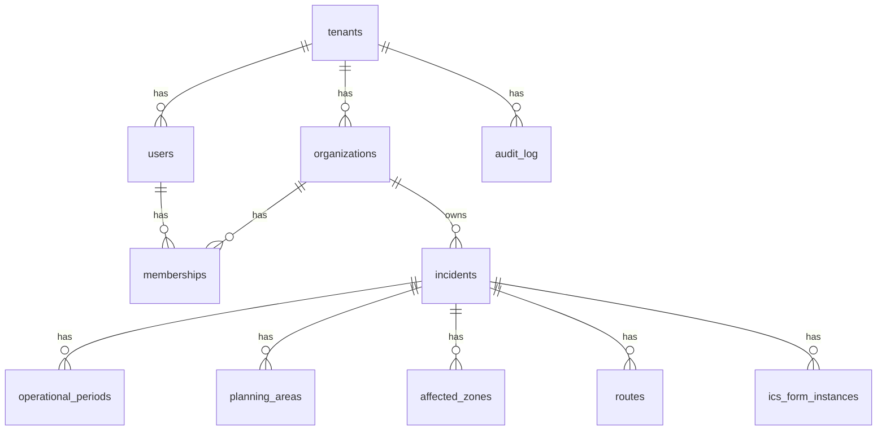

# Data model and multi-tenant RLS

This document describes the PostgreSQL + PostGIS schema for InCommand Mitiga Phase 1 and how **row-level security (RLS)** enforces tenant isolation.

## Entity overview



## Tables (summary)

| Table | Purpose |
|-------|---------|
| `tenants` | SaaS customer boundary |
| `organizations` | Departments / EOCs within a tenant |
| `users` | Login identity; belongs to tenant |
| `memberships` | User ↔ org with `role` enum |
| `incidents` | Incident or exercise record + lifecycle state |
| `operational_periods` | Numbered OPs for an incident |
| `planning_areas` | Polygon geometry (SRID 4326) |
| `affected_zones` | Polygon **or** circle (center + `radius_meters`) |
| `routes` | LineString geometry (SRID 4326) |
| `ics_form_instances` | Typed ICS payload (JSONB) + version |
| `audit_log` | Append-only security/audit events |

## PostGIS

- Extension `postgis` enabled in migration `0001_initial.sql`.
- Geometries stored as `geometry(Geometry, 4326)` or specific subtype where noted.

## Session variable for RLS

All tenant-scoped policies use:

```sql
current_setting('app.tenant_id', true)::uuid
```

**Application rule:** every server request that touches tenant data must run inside a transaction after:

```sql
SET LOCAL app.tenant_id = '<uuid>';
```

`SET LOCAL` scopes the variable to the current transaction only (safe for connection pools).

If `app.tenant_id` is not set, policies **deny** access (fail closed).

## Role used by the app

- **`mitiga_app`**: non-superuser DB role used by the application with `BYPASSRLS` **disabled** so RLS always applies.
- Migrations run as owner (superuser or migration role); RLS policies apply to `mitiga_app`.

## Policy pattern

Example for `incidents`:

- `SELECT` / `INSERT` / `UPDATE` / `DELETE` allowed only when `incidents.tenant_id = current_setting('app.tenant_id', true)::uuid`.

Organizations are scoped both by `tenant_id` and by membership checks where needed (Phase 1: org-scoped reads can be enforced in app layer; optional `app.org_ids` expansion later).

## Indexes

- B-tree on `(tenant_id, updated_at DESC)` for incident lists.
- GiST on geometry columns for spatial queries.

## Migrations

Canonical SQL: [`migrations/0001_initial.sql`](../migrations/0001_initial.sql) and [`migrations/0002_auth_rls_force.sql`](../migrations/0002_auth_rls_force.sql).

## Authentication helper

Login uses the `SECURITY DEFINER` function `lookup_user_for_login(tenant_slug, email)` (see migration `0002`) so credentials can be validated **before** `app.tenant_id` is set. `EXECUTE` is revoked from `PUBLIC`; the application database role should be granted `EXECUTE` in hardened deployments (table owners can still execute during local dev).

## `FORCE ROW LEVEL SECURITY`

Migration `0002` enables **FORCE** on all tenant-scoped tables **except** `tenants`, so bootstrap scripts using the **table owner** role can still insert the first tenant while child tables remain strictly enforced when `FORCE` applies.

## TypeScript / Drizzle mirror

TypeScript types / Drizzle definitions: [`src/db/schema.ts`](../src/db/schema.ts) (mirror for application queries). PostGIS geometry tables are SQL-first; helpers live in [`src/db/geo.ts`](../src/db/geo.ts).

