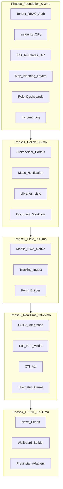

# InCommand Mitiga — TOR mapping and delivery roadmap

This document maps the **Terms of Reference (TOR)** for an Integrated Risk Management / Incident Command IMS to **InCommand Mitiga**. Treat the TOR as a **capability checklist**, not a literal technology prescription—many items assume turnkey hardware, proprietary radio stacks, and 2010s-era integrations. Mitiga should **exceed** the TOR on software UX, security, and cloud-native operations while **integrating** with provincial systems and certified vendors where required.

---

## 1. Deployment model (from TOR, modernized)

| TOR concept | Mitiga interpretation |
|-------------|----------------------|
| 8 locations (1 JOC + 7 regional) | **One multi-tenant platform**, **8 org sites** (or 1 tenant with 8 `organizations`), not 8 duplicated apps |
| 50 users @ main, 10 @ each regional (~120 total) | Size for **150 concurrent** web sessions, **500 named users**, burst on activation |
| Web-based / cloud | **SaaS-first** (Vercel/Neon or sovereign cloud); optional **hybrid** (cloud control plane + on-prem media/SIP edge) |
| Internet + private APN/WAN | **Split endpoints**: public HTTPS for portals; **private link / VPN / APN** for tracking ingest, CCTV, radio gateways |
| Multi-tenant, no DB duplication | **Single Postgres cluster**, `tenant_id` + RLS; optional **dedicated DB per government tenant** for large customers |
| 36-month contract / 3-month implementation | **Phase 0–2 in ~3 months** (core IMS + portals + ICS + map + dashboard); hardware/voice/CCTV in parallel via integrators |

**Out of scope for Mitiga software repo (integrator / prime contractor):** racks, UPS, furniture, physical radios, PABX handsets, NVR cameras (API integration only), WAN circuits, printers, conference room AV (§2.4–2.11, §11–13).

---

## 2. TOR section → Mitiga module map

### §2 / §3 Mandatory platform

| TOR | Mitiga module | Notes |
|-----|---------------|--------|
| 3.1 Web-based IMS | **Web app** (Next.js), responsive + future native shells | Current UI shell aligns with “control centre dashboard” pattern |
| 3.2 Cloud | **Managed cloud** + DR; document data residency | Gov may require in-country region |
| 3.3 Internet + APN/WAN | **Edge gateway** + mTLS device ingest | Not “one monolith URL” |
| 3.4 Multi-tenant | **Tenants, orgs, sites**, RLS | Already in data model direction |
| 3.5.1 Incident planning + ICS templates | **Incidents, operational periods, ICS forms** | FEMA + HICS template library |
| 3.5.2 Mapping + live traffic | **Map engine** (OSM/Carto + licensed traffic/routing) | Avoid scraping; licensed APIs |
| 3.5.3 Multi-agency tracking | **Tracking service** (LBS, PMR/LTE via partners) | Normalize to `tracked_asset` + positions stream |
| 3.5.4 Provincial interoperability | **Integration hub** (adapters, certification matrix) | Bid requirement—not build-all |

### §4 Information Management System (core)

| TOR clause | Capability | Phase |
|------------|------------|-------|
| 4.1 DRM planning / response / mitigation | **Lifecycle**: plan → activate → respond → demobilize → AAR | P1–P2 |
| 4.2–4.5 Stakeholder **portals** (URL, email, activation level) | **Incident portal** per event; states: planning / activated / closed | P2 |
| 4.6 Lists/libraries (personnel, resources, shelters, CII, tasks) | **Structured lists** + GIS links | P2 |
| 4.7 Mass comms to personnel/resources | **Notifications** (SMS/email/push) via providers | P2 |
| 4.8 Document management + version + workflow | **Docs module** (S3 + versions + approval) | P2–P3 |
| 4.9 Real-time incident log → situational awareness | **Incident log** + dashboard widgets | P1 |
| 4.10–4.12 ICS → IAP; templates per **operational period** | **ICS instances** bound to OP; PDF/JSON export | P1–P2 |
| 4.13 Early warning / telemetry | **Alert ingest** (CAP, RSS, MQTT, SCADA adapter) | P3 |
| 4.14 Integration (wallboards, GIS, multi-agency tracking) | **API + WebSocket** + partner adapters | P2–P4 |
| 4.15 Functional views (Command, Planning, Ops, Logistics, Finance, Mitigation) | **Role-based workspaces** (not one flat dashboard) | P2 |

#### §4.15 functional views (product surfaces)

| ICS function | Primary widgets / data (from TOR) | Mitiga workspace |
|--------------|-----------------------------------|------------------|
| **Command** | OPs, situation, contacts, command tasks, impacted locations | `workspace=command` |
| **Planning** | Set OPs, ICS workflow, situation, IAP reports, planning tasks | `workspace=planning` |
| **Operations** | Activation, situation, shelters, locations, log, ops tasks, triggers (resource request, upload, alerts, map tasks) | `workspace=operations` |
| **Logistics** | Situation, resource requests, logistics tasks | `workspace=logistics` |
| **Finance / Admin** | POs, resource requests, contracts, situation | `workspace=admin_finance` |
| **Mitigation** | Risk plans, long-term projects | `workspace=mitigation` |
| **Images & feeds** | CCTV, upload library, RSS | `workspace=media` |
| **Mapping** | CAD map, resource map, risk layers (ArcGIS/shapefile), ICS on map | `workspace=map` (shared) |

### §5 Wallboards and dashboards

| TOR widget | Mitiga |
|------------|--------|
| Incidents by type / area | **Wallboard layouts** (configurable grid); link to §5.1.1–5.1.2 |
| Task requests by agency | **Task queue** widget |
| Map + activation status | **Map wallboard** layer |
| Weather (NOAA) | **Weather provider** (US: NWS; global: Open-Meteo); label provenance |
| Live news | **Licensed feeds / RSS / GDELT**—not unofficial scraping |
| Resource map (radio, trackers, mobile) | **Live positions layer** on map | P3–P4 |

Current **InCommand-style dashboard** = **Operations default wallboard** (empty states until data exists). Add **layout presets**: JOC master, regional, planning room.

### §6 SMS / paging

| TOR | Mitiga |
|-----|--------|
| Group SMS on IAP activation | **Notification rules engine** tied to OP/IAP publish event |
| Group/individual paging | **Contact groups** + templates + audit log |

Provider examples: Twilio, Africa’s Talking, gov SMS gateway—**adapter interface**.

### §7 CTI

| TOR | Mitiga |
|-----|--------|
| CLI → ALI for call taker | **CTI webhook** from PABX; pop incident/caller card; no dialer duplication |

Software receives events; **PABX is integrator-supplied**.

### §8 Resource tracking

| TOR | Mitiga |
|-----|--------|
| Multi-vendor, multi-network | **Tracking ingestion API** + normalised model |
| Fleet/telematics options | **Optional modules** or partner (don't build full ERP in v1) |
| Map providers (Bing/Google/OSM) | **Map provider abstraction** (already started) |
| Private APN + Internet | **Separate ingest endpoints** |
| Provincial certification | **Certified adapter list** |

### §8.2 Mobile

| TOR | Mitiga |
|-----|--------|
| Mobile views | **PWA + native** (Phase 2 RFC) |
| Forms builder (damage assessment) | **Form schema engine** (Phase 2+) |
| Mapping on device | Mobile map SDK |
| Tracker / PTT / navigation | **Integrate** bodycam/SIP/nav (Phase 3)—see RFC-003 |

### §9 Alarm monitoring

**Event bus** for: SCADA, commercial alarms, HTML incidents, RSS → `external_signal` → optional auto-create/link incident.

### §10 Radio / PTT

**Not application-only.** Architecture:

- **SIP/RTP media plane** (Phase 3)
- **Radio gateways** (hardware) on WAN
- **Dispatcher console** (web or thick client) via integrator
- Mitiga stores **channel metadata**, recordings catalog, incident linkage

### §11–13 IT infrastructure, CCTV, voice recording

| Area | Mitiga role |
|------|-------------|
| Server room, UPS, WAN, printers | **Exclude** from software scope |
| CCTV (8× 2MP/site, 60-day NVR) | **Integrate** via ONVIF/RTSP/API; plot on map; wallboard tile |
| Digital voice recording | **Metadata + playback URLs** from recorder API; tag exchange when supported |

---

## 3. Phased delivery (software) — 36 months compressed to product phases

**3-month TOR implementation window (software):** deliver **Phase 0** at 8 sites (config + training), **stub integrations** for provincial systems, **pilot** tracking/CCTV where vendors ready.

---

## 4. Data model extensions (TOR-driven)

Beyond current schema (`tenants`, `organizations`, `incidents`, `operational_periods`, geometries, `ics_form_instances`, `audit_log`):

| Domain | Key entities |
|--------|----------------|
| Portal | `incident_portal`, `portal_activation_level`, `portal_member` |
| Lists | `person`, `resource`, `facility`, `shelter`, `critical_infrastructure`, `task` |
| Comms | `contact_group`, `message_template`, `notification`, `delivery_status` |
| Documents | `document`, `document_version`, `workflow_state` |
| Tracking | `tracked_asset`, `position_event`, `device_vendor` |
| Media | `media_asset`, `cctv_camera`, `feed_subscription` |
| Integration | `external_signal`, `adapter_config` |
| Wallboard | `dashboard_layout`, `widget_config` |

---

## 5. Non-functional requirements (from TOR + modern bar)

| Area | Target |
|------|--------|
| Availability | 99.9% SaaS; RTO/RPO documented |
| Support | 24×7 per SLA—ops runbooks, status page |
| Security | MFA, RBAC, audit, encryption, POPIA/PAIA alignment |
| Performance | 120 concurrent users; map tile CDN; WS for live layers |
| Training | Train-the-trainer; 4-shift scheduling (TOR §15) |
| Licensing | Per-seat or per-site; SLA includes subscription |

---

## 6. Current codebase vs TOR (honest gap)

| TOR area | Today | Next build step |
|----------|--------|-----------------|
| Web IMS | InCommand-style **empty dashboard** | Wire to real `incidents` + role workspaces |
| ICS templates | Schema + docs; no UI | ICS form editor per OP |
| Mapping | MapLibre widget; no draw/layers | Planning tools + ArcGIS adapter |
| Multi-tenant | SQL + RLS designed; auth optional | Re-enable auth + site/org model |
| Portals | — | Portal module P2 |
| Tracking / PTT / CCTV | RFCs only | Integrations per phase |
| Wallboards | Single layout | Configurable wallboard builder |
| Mass notification | — | Notification service P2 |

---

## 7. Bid / compliance checklist (for proposals)

- [ ] Multi-tenant architecture diagram (1 app, 8 sites, 120 users)
- [ ] Provincial interoperability matrix (certified systems + APIs)
- [ ] ICS FEMA + HICS form list with IAP export
- [ ] Map stack (OSM + commercial + ArcGIS)
- [ ] Tracking: vendor-agnostic ingest
- [ ] Mobile roadmap (PWA → native)
- [ ] Hardware/radio/WAN: **partner** scope of work
- [ ] 3-month implementation plan with milestones
- [ ] SLA: 24×7, license-inclusive pricing split (capital vs annual)
- [ ] Reference sites / training plan (14 trainers, shift-aware)

---

## 8. Principles (build higher than the TOR)

1. **API-first** — every UI feature has a public API for provincial integration.
2. **Event-sourced incident timeline** — log, audit, and wallboard from one stream.
3. **Configurable, not custom** — wallboards, forms, portals via config where possible.
4. **No scraping** — weather, traffic, news via licensed/official feeds.
5. **Separation of planes** — control data (Postgres) vs media (WebRTC/SIP) vs device ingest (edge).
6. **Zero-trust between sites** — org-scoped data; cross-site only when explicitly shared.

---

## Related docs

- [PRD-PHASE1.md](./PRD-PHASE1.md)
- [DATA-MODEL-RLS.md](./DATA-MODEL-RLS.md)
- [RFC-002-field-mobile-sync.md](./rfc/RFC-002-field-mobile-sync.md)
- [RFC-003-webrtc-sip-media.md](./rfc/RFC-003-webrtc-sip-media.md)
