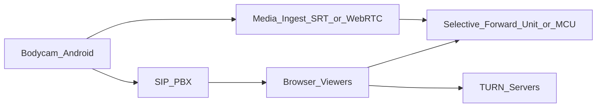

# RFC-003 — WebRTC, SIP/PTT, and live media pipeline (Phase 3)

**Status:** Draft  
**Scope:** Body-worn Android devices, live camera streams, and push-to-talk over SIP on dedicated logical channels.

## Goals

- **Low-latency** one-to-many video from field devices to command viewers (browser).
- **SIP** trunking / on-prem PBX interoperability for PTT groups (e.g., Asterisk/FreeSWITCH or managed CPaaS).
- **Clear security boundary** between **application API plane** and **media plane**.

## High-level architecture

## Components

1. **Ingest:** SRT or WebRTC WHIP from device; authenticate with short-lived **device tokens** tied to tenant + incident.
2. **Distribution:** self-hosted **LiveKit/mediasoup** or vendor SFU; record to **object storage** with retention policy.
3. **SIP bridge:** map ICS talkgroups to SIP rooms; optional **OPUS** transcoding.
4. **Signaling service:** coordinates join tokens, ICE servers, and channel membership.

## Security

- Separate **media keys** from database credentials.
- **Per-channel ACL** enforced at signaling layer; audit all joins/leaves.
- **Retention** and **legal hold** hooks per tenant.

## Non-goals (Phase 3)

- Replacing carrier-grade LMR/LTE mission-critical voice for primary response (integration only).

## Open decisions

- Vendor vs self-hosted SFU for air-gapped customers.
- Recording consent UX and jurisdictional requirements.
